<div align="center">


# Siphon

**A fast, native download manager for macOS, written in Rust.**

Segmented downloads that start the moment you click, resume after anything,<br>
and take over from Chrome, Brave, Edge, Dia and Arc. YouTube, HLS and FTP included.

[](https://github.com/soufian3hm/siphon/releases/latest)
[](https://github.com/soufian3hm/siphon/releases)


### [Download Siphon for macOS](https://github.com/soufian3hm/siphon/releases/latest)

<sub>One 21 MB disk image · no web view, no Electron · the whole interface is drawn on the GPU</sub>

<br>

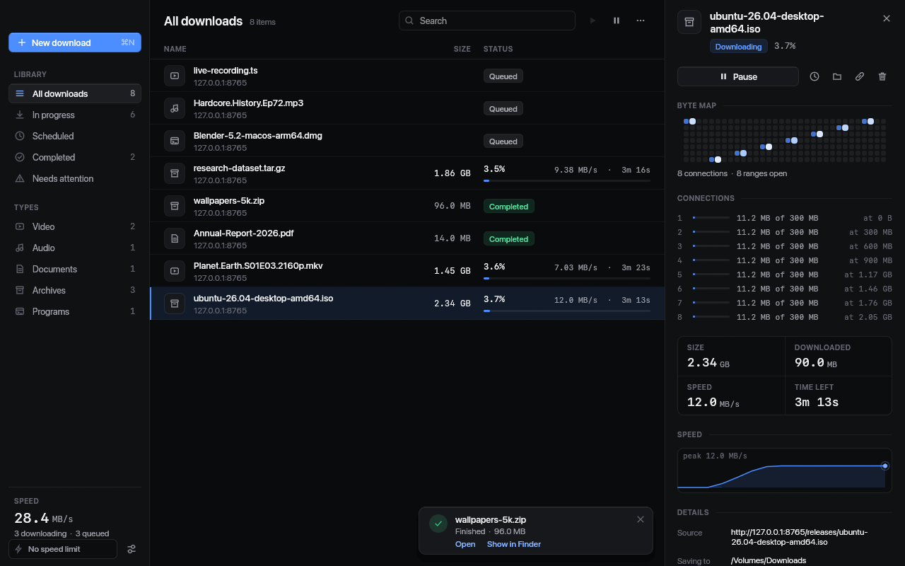

</div>

<br>

## Why Siphon

Internet Download Manager set the standard for what a download manager does:
it splits a file across several connections, takes downloads over from the
browser, starts fetching before you have answered the save dialog, and picks
a transfer up again after a crash or an expired link. It is also Windows-only.

Siphon is that way of working, built for the Mac from scratch:

- **A real engine.** Dynamic segmentation, positional writes into one
  pre-sized file, checkpoints that can never claim bytes that are not on disk.
- **A native application.** Pure Rust and [egui](https://github.com/emilk/egui):
  no web view, no Electron, no background service.
- **Honest about itself.** Every feature below is exercised by the test suite
  or by a real browser. What has *not* been verified is
  [listed in this file](#what-has-been-verified-and-what-has-not), not hidden.

## Contents

- [Install](#install)
- [Features](#features)
- [Browser extension](#browser-extension)
- [YouTube and other video pages](#youtube-and-other-video-pages)
- [Command line](#command-line)
- [How the engine works](#how-the-engine-works)
- [What has been verified, and what has not](#what-has-been-verified-and-what-has-not)
- [Build from source](#build-from-source)
- [Keyboard](#keyboard)
- [Questions](#questions)

## Install

1. Download **`Siphon-0.3.0.dmg`** from the
   [latest release](https://github.com/soufian3hm/siphon/releases/latest).
2. Open it and drag Siphon onto Applications. Or simply open Siphon inside the
   image: it offers to move itself into the Applications folder, starts again
   from there and ejects the image.
3. On first start Siphon finds your browsers and opens **Settings → Browser**,
   where one button per browser [adds the extension](#browser-extension).

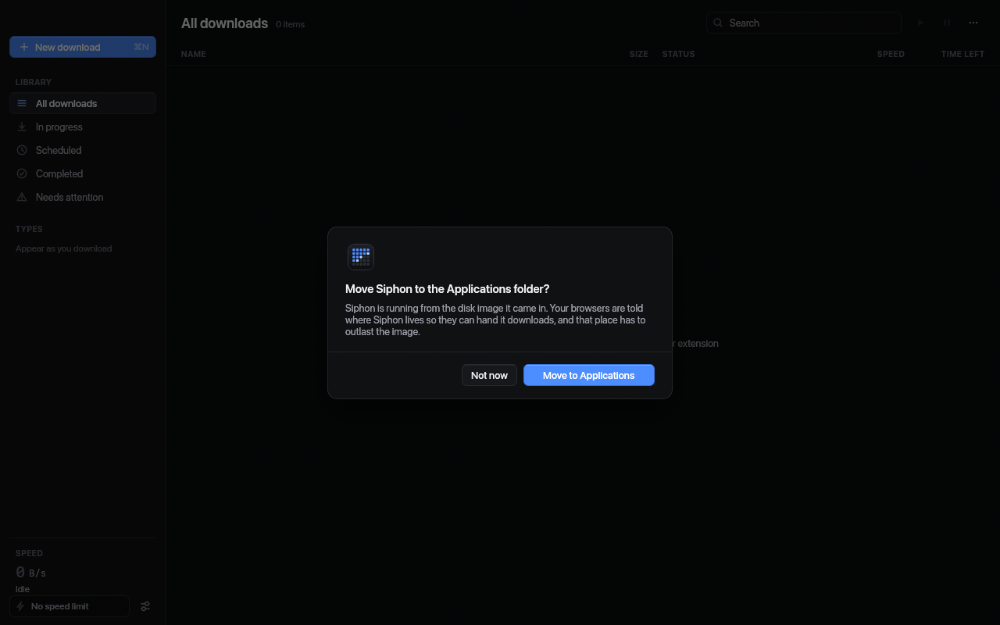

Built for macOS 11 or later, on Apple silicon and Intel Macs.

> [!IMPORTANT]
> Siphon is not notarised by Apple yet, so macOS stops it the first time:
> *“Apple could not verify Siphon…”*. Open **System Settings → Privacy &
> Security**, scroll to the message about Siphon and press **Open Anyway**.
> This is needed once.

## Features

<table>
<tr>
<td width="50%" valign="top">

### Instant start

A link starts downloading the moment it arrives, behind the dialog that asks
where to save it. Forget the dialog for a minute and it reads *Already
downloaded*. Say yes and the file is yours; say no and nothing is left behind.

</td>
<td width="50%">
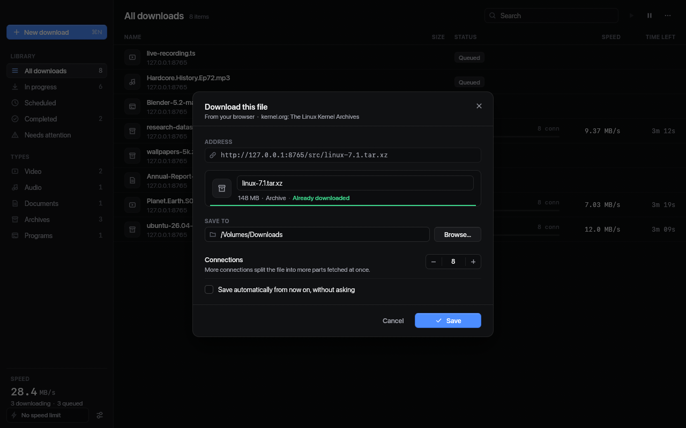
</td>
</tr>
<tr>
<td width="50%" valign="top">

### Link grabber

Reads a page, and the pages it links to, and lists every file, image and
media address with type filters and check boxes. *Download all links with
Siphon* in the browser's context menu sends the open page to the same picker.

</td>
<td width="50%">
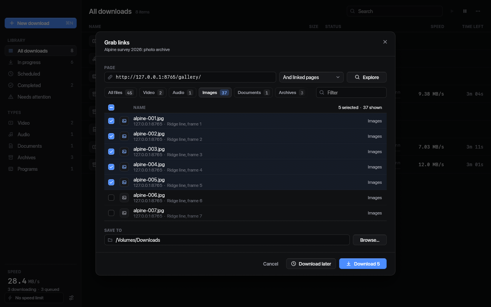
</td>
</tr>
<tr>
<td width="50%" valign="top">

### Queue and schedule

*Download later* sets a download aside. The queue runs when you start it, or
by itself at a time of day on chosen weekdays, and can stop at another. When
it is done Siphon can quit or put the Mac to sleep.

</td>
<td width="50%">
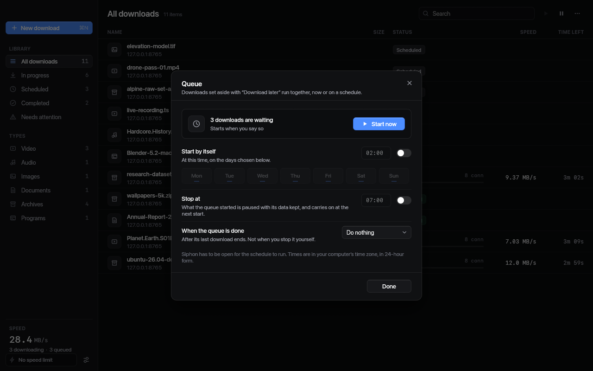
</td>
</tr>
<tr>
<td width="50%" valign="top">

### Look inside before downloading

For a ZIP archive, and the formats built on it (`.jar`, `.apk`, `.epub`,
`.docx`), *See what is inside* lists the contents from two small requests,
without fetching the archive.

</td>
<td width="50%">
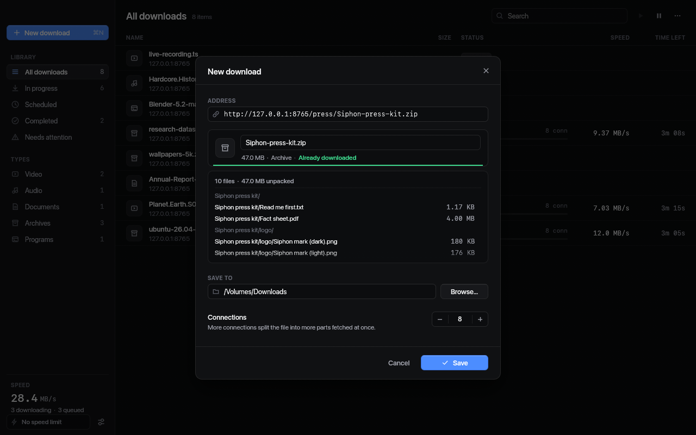
</td>
</tr>
<tr>
<td width="50%" valign="top">

### Many at once

Paste a list, or write a series: `photo[001-120].jpg`, `disc-[a-d].iso`,
`{mon,tue,wed}.mp3`. Links can be imported from a text or HTML file and
exported again.

</td>
<td width="50%">
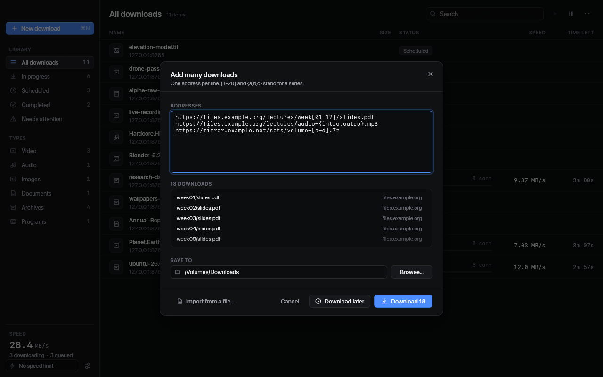
</td>
</tr>
<tr>
<td width="50%" valign="top">

### Checksums

*Verify checksum* computes SHA-256, SHA-1 or MD5 of a finished file and
compares it with the value its publisher lists. A pasted checksum picks the
right algorithm by its length.

</td>
<td width="50%">
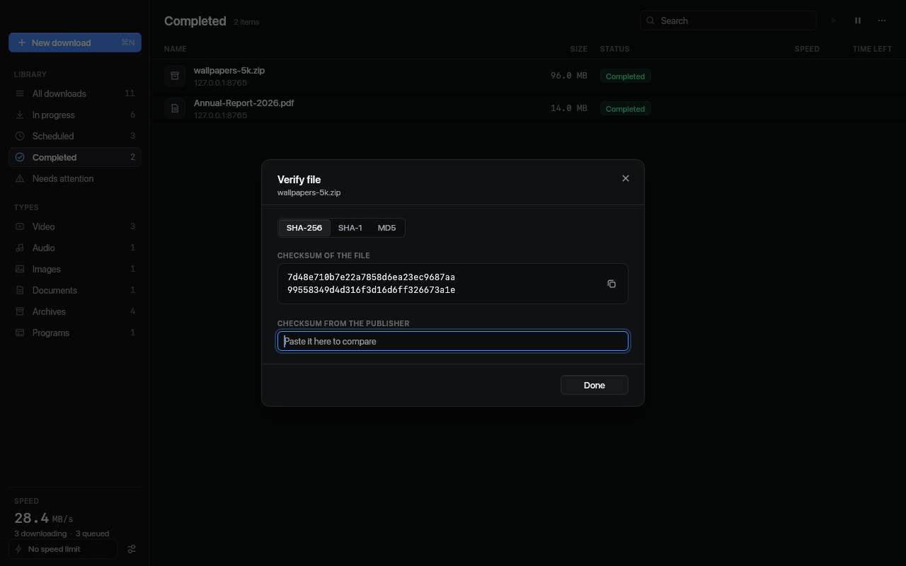
</td>
</tr>
</table>

**And the rest**

| | |
|---|---|
| **Segmented transfers** | Up to 32 connections per file, split and re-split while the download runs. See [how the engine works](#how-the-engine-works). |
| **Resume after anything** | Quit, crash, power cut, sleep, a dropped connection. The byte map is checkpointed every 1.5 s. |
| **Expired links** | A download whose link stopped working keeps its data. *Refresh link* opens the page it came from and waits; start the download there again and Siphon carries on with the new link. |
| **Takes over from the browser** | A clicked download arrives with the browser's cookies, referrer and user agent. Hold **Alt** to leave one to the browser, or exclude a site, file types or small files. |
| **Comes forward** | A captured link brings Siphon's window to the front, also when it was minimised or covered. |
| **Sort by type** | Files are filed into Video, Music, Pictures, Documents, Archives and Programs. Folders and extensions are yours to change. |
| **Per-site rules** | A connection limit for servers that allow one or two, and a login sent as HTTP Basic or as the FTP account. Passwords live in the macOS Keychain, never in a settings file. |
| **When a download finishes** | A card with *Open* and *Show in Finder*. The file gets the quarantine attribute and its source address as a browser would set them, optionally the server's date, optionally a command of yours. |
| **Protocols** | HTTP, HTTPS, FTP (segmented with `REST`), HLS playlists with AES-128, MMS over HTTP. |
| **Proxies** | System, direct or manual: HTTP, HTTPS, SOCKS5. Basic, NTLM, Negotiate and Kerberos authentication. |
| **Speed limit** | One limit for everything, changed while downloads run. |
| **Stays awake** | The Mac is kept from idle-sleeping while downloads run. |

## Browser extension

Siphon works with every Chromium-family browser it finds: **Google Chrome**
(also Beta and Canary), **Dia**, **Brave**, **Microsoft Edge**, **Arc**,
**Vivaldi**, **Opera** and **Chromium**. On each start it tells every one of
them where its helper is and saves the extension to a folder that stays put:

```text
~/Library/Application Support/app.Siphon.Siphon/Siphon Extension
```

**Settings → Browser** lists the browsers it found with their own icons,
says for each whether the extension has been added, and keeps itself current
while it is open.

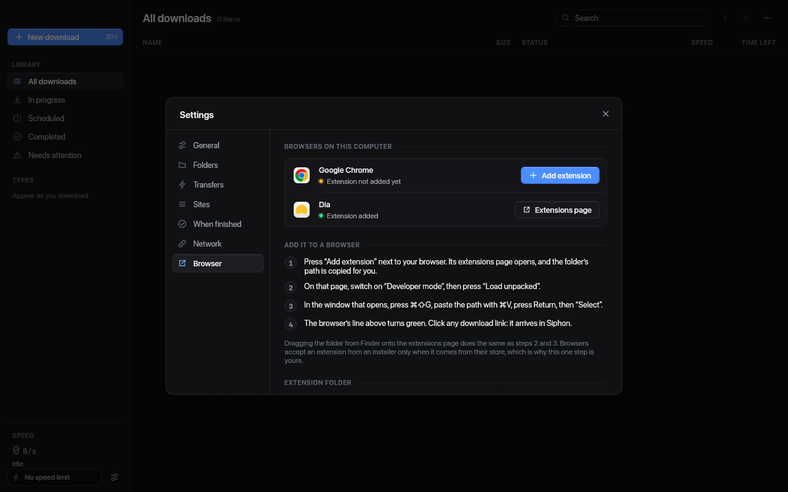

1. Press **Add extension** next to the browser. Its extensions page opens and
   the folder's path is copied.
2. On that page switch on **Developer mode** and press **Load unpacked**.
3. In the window that opens press <kbd>⌘</kbd><kbd>⇧</kbd><kbd>G</kbd>, paste,
   press Return, then **Select**. Dragging the folder from Finder onto the
   page does the same.
4. The browser's line in Siphon turns green. Click any download link: it
   arrives in Siphon instead of the browser's download bar. If Siphon cannot
   be started, the browser downloads as usual.

After an update of Siphon, press the reload arrow on the extension's card.

<table>
<tr>
<td width="62%">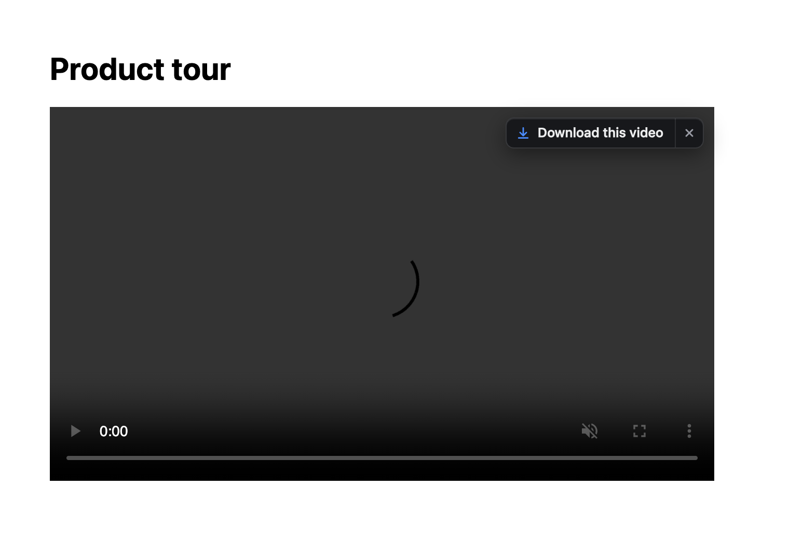</td>
<td width="38%">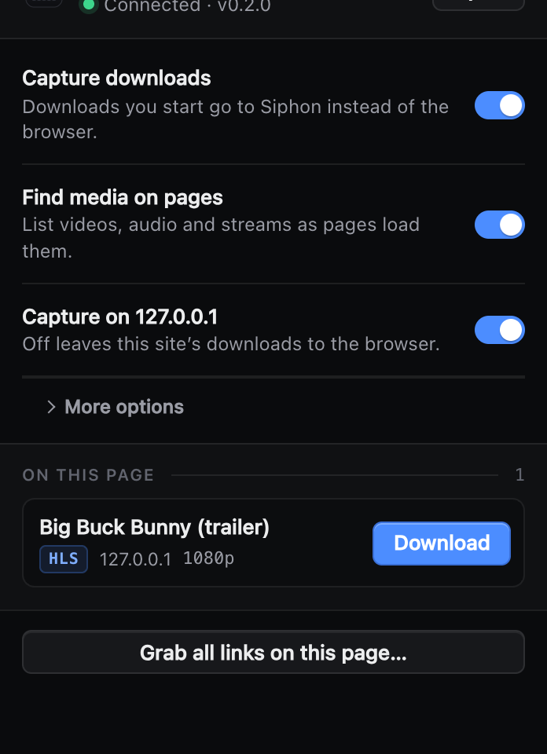</td>
</tr>
<tr>
<td valign="top">On a page where a video or stream was noticed, a download button appears by the player.</td>
<td valign="top">The popup lists the same media, and switches capture off for a site, a file type or small files.</td>
</tr>
</table>

<details>
<summary><b>Why is that one step manual?</b></summary>

<br>

On macOS and Windows, Chromium browsers accept an extension from an installer
only when the extension is hosted in the Chrome Web Store: the installer
leaves a small pointer file, the browser fetches the extension from the store
and asks the user to switch it on. That is how other download managers add
theirs.

Siphon has that mechanism (`browser::WEB_STORE_ID` and
`Browser::add_from_store`). It stays off until the extension has a store
listing, and a store build could not include downloading from YouTube, which
the store's rules forbid.

The extension's ID is fixed by the key in its manifest, so the helper's
allow-list is known in advance and nothing has to be pasted anywhere.

</details>

## YouTube and other video pages

The download button also appears on YouTube watch and Shorts pages.

Finding the streams behind such a page is left to
[yt-dlp](https://github.com/yt-dlp/yt-dlp), which has to be installed:

```bash
brew install yt-dlp ffmpeg
```

Siphon then downloads picture and sound with its own engine, in small ranged
requests as the site expects, and joins them with `ffmpeg`. The add dialog
offers the available qualities, from 2160p down to sound only; the default is
1080p (Settings → General). A stream address that expires mid-download is
looked up again once, by itself. **Settings → Browser** tells you whether both
tools were found.

Plain HLS streams (`.m3u8`) need neither tool: Siphon assembles them itself,
and uses `ffmpeg`, when present, only to repackage the result as MP4.

DRM-protected streams and live streams are refused. Download only what you
have the right to download.

## Command line

```text
siphon                          open the application
siphon <address>...             hand addresses over; Siphon asks where to save
siphon add <address>... [--dir <folder>] [--name <file name>]
                        [--referer <page>] [--later] [--ask]
siphon queue start|stop
siphon browsers                 list the browsers found, and how each stands
siphon install [<folder>]       copy this application into Applications
```

`add` adds without asking. When Siphon is already running the request is
passed to it. Addresses may use series: `file[01-20].zip`, `part-{a,b,c}.bin`.
Inside the bundle the binary is `Siphon.app/Contents/MacOS/siphon`.

## How the engine works

**Dynamic segmentation.** A file is never cut into fixed chunks. It starts as
one range. Each additional connection takes the largest unfetched range and
cuts it in half; the same happens every time a connection runs out of work.
A range is only split when it is big enough to be worth a connection *and* its
owner would still need a couple of seconds to finish it, because a steal
abandons whatever the server already had in flight.

**Disk.** The file is reserved at full size before the first byte arrives.
Connections write with positional writes (`pwrite`, `WriteFile` with an
offset) through one shared handle; there is no lock on the write path, and no
temporary pieces to stitch together afterwards.

**Resume.** Every 1.5 s the byte map and the server's validators are written
to a sidecar next to the partial file: captured, then the data file is
flushed, then the sidecar is replaced atomically. A checkpoint can therefore
only claim bytes that were already durable. On resume the size must match, and
the `ETag` too when the file is still served from the same place.

**Moving a running download.** When the destination changes while a file is
being written (instant start, then a different folder in the dialog), the
transfer is not interrupted. The new destination is recorded and the files
move the moment the transfer lets go of them: at completion, or when it stops.

**Expired links.** A download's identity (destination, size, byte map) is
separate from the URL it is fetched from. When a link starts answering `401`,
`403`, `404` or `410`, the download stops with its data intact and waits.
Redirect targets that expire mid-transfer are resolved again from the original
link without involving the user.

**Protocols.** HTTP and HTTPS (HTTP/1.1 on purpose: one TCP flow per
connection is the point of segmenting); FTP, segmented with `REST`; HLS
playlists, assembled into one file with AES-128 support; MMS over its HTTP
transport.

**Proxies.** System, direct or manual (HTTP, HTTPS, SOCKS5). Basic
authentication natively; NTLM, Negotiate and Kerberos through an in-process
bridge that performs the connection-level handshake.

## What has been verified, and what has not

**Verified by the test suite** (`cargo test --workspace`, 197 tests) against
local servers: segmentation and stealing, pause and resume, recovery after a
kill between checkpoints, expired links and link swapping, changed files,
servers without ranges or sizes, dropped connections, connection caps, the
speed limit, FTP, HLS (including a real stream made with `ffmpeg` and checked
with `ffprobe`), the MMS framing, the NTLM handshake, the queue, persistence
and the local IPC; instant start (accept, move, rename, decline, quit, typed
links, streams, past the slot limit), the deferred queue and its automatic
start inside a scheduled window, per-site connection limits and Basic logins,
sorting into folders, duplicate detection, the finishing steps (quarantine and
source attributes, server date, command), checksums against published test
vectors, the ZIP listing (including ZIP64), the link grabber at depths 0 to 2,
the wait for a fresh link, series patterns, the sleep hold, and the command
line; video pages end to end against a stand-in resolver, including a stream
address that expires mid-download; browser detection, the helper's
registration, the saved extension folder and the store pointer; the copy into
the Applications folder (replacing an older copy, failing safely); and
drawing an application's icon.

Three tests are run on request only: one writes to the real system keychain,
one waits for the wall clock to reach the scheduled start and stop times, one
describes a real video page over the network. All three have passed:

```bash
cargo test -p siphon-core --lib secrets -- --ignored
cargo test -p siphon-core --test workflow clock -- --ignored
cargo test -p siphon-core --test workflow real_video -- --ignored
```

**Verified with a real Chromium** (`node scripts/e2e-extension.mjs <chromium>`,
27 checks): download interception, the helper starting the application,
cookies, referrer and user agent hand-over, stream detection and the popup,
Alt held while clicking, a file type and a site left to the browser, the
download button by a video and the download it starts, and a page's links
reaching the link picker.

**Verified by hand on the Mac that built it:** the disk image mounts and
passes `hdiutil verify`; the application inside is validly signed, knows it is
on an image, and copies itself out intact on both the Apple silicon and the
Intel slice (the latter under Rosetta); a Chromium browser asked to open its
extensions page opens it.

**Not verified**, stated plainly:

- **The installer on another Mac.** Developer ID signing and notarisation are
  in the build scripts but were not exercised: they need an Apple developer
  account. The *Open Anyway* route above is how macOS treats any application
  that is not notarised; it has not been walked through on a second machine.
- **An Intel Mac, and older versions of macOS.** The Intel slice was run under
  Rosetta, not on Intel hardware. The build targets macOS 11; it has been run
  on macOS 27 only.
- **Adding the extension from the store.** The pointer file is written and
  removed correctly in the tests; no store listing exists to fetch from.
- **Browsers other than Chrome and Dia.** Detection and the helper's
  registration follow each browser's documented folders; only those two were
  installed to try.
- **Windows and Linux.** The code has the platform branches (positional
  writes, registry registration, paths, credential stores) but has only been
  built and run on macOS.
- **Kerberos and Negotiate** proxy authentication need a domain controller to
  test against. The handshake code is in place; it has not met a real KDC.
- **MMS** has been tested against a server written for the tests. Public
  MMS servers no longer exist to test against.
- **FTP logins from a site rule** share the code path of the tested HTTP
  logins up to the point where the account is put into the address; that last
  step has not been run against an FTP server that demands a password.
- **Sleep when the queue is done** calls `pmset sleepnow`. The countdown and
  the cancel were exercised; the sleep itself was not triggered.
- **HLS → MP4** uses `ffmpeg` when it is installed. Without it, MPEG-TS
  streams are saved as `.ts` (which plays everywhere) and separate audio
  renditions are saved as a second file.

**Not built:**

- **DASH** (`.mpd`) streams are detected by the extension but not assembled.
  **Live** HLS streams and DRM-protected streams are refused. Playlists of
  video pages are not expanded: one page, one video.
- **FTPS**, torrents and magnet links.
- A **Firefox** or **Safari** extension.
- Several queues, synchronisation queues, download quotas (so many megabytes
  per hour), shutting the computer down (sleep and quit only), sounds,
  clipboard monitoring (macOS now asks the user each time an app reads the
  clipboard unprompted), dragging links onto the window, a menu-bar icon, and
  automatic updates.
- The schedule only runs while Siphon is open.
- File sizes are not shown in the link grabber's list.

## Build from source

Requires Rust 1.100 or later and the Xcode command line tools.

```bash
git clone https://github.com/soufian3hm/siphon.git
cd siphon
scripts/make-dmg.sh            # release build → dist/Siphon-<version>.dmg
scripts/bundle-macos.sh        # only the application → dist/Siphon.app
```

During development: `cargo run -p siphon`. Tests: `cargo test --workspace`.

```text
crates/core        the engine (library): segmentation, resume, protocols, queue
crates/app         the application (egui/eframe) and its command line
crates/host        native-messaging host: the browser's line to the application
crates/testserver  a deliberately misbehaving server for tests and demos
extension/         Chrome extension (Manifest V3)
scripts/           bundling, the disk image and the browser end-to-end check
```

The bundle is built for the processor of the Mac that builds it. With
`rustup target add x86_64-apple-darwin` on Apple silicon it is built for both
and joined with `lipo`.

**Signing and notarising.** The scripts sign ad hoc by default. With a
Developer ID they sign with the hardened runtime, send the image to Apple and
staple the ticket:

```bash
export SIPHON_SIGN_IDENTITY="Developer ID Application: Your Name (TEAMID)"
export SIPHON_NOTARY_PROFILE="siphon"   # xcrun notarytool store-credentials siphon
scripts/make-dmg.sh
```

**Screenshots** are taken by the application itself: `SIPHON_SHOTS=<plan>`
scripts it against the demo server (`cargo run -p siphon-testserver -- --port
8765`). The commands are listed at the top of `crates/app/src/shots.rs`.

## Keyboard

| | |
|---|---|
| <kbd>⌘</kbd><kbd>N</kbd> | New download |
| <kbd>⇧</kbd><kbd>⌘</kbd><kbd>N</kbd> | Add many links |
| <kbd>⌘</kbd><kbd>G</kbd> | Grab links from a page |
| <kbd>⌘</kbd><kbd>V</kbd> | Paste a link (several links open *Add many links*) |
| <kbd>Space</kbd> | Pause or resume the selection |
| <kbd>↵</kbd> | Open the finished file |
| <kbd>⌘</kbd><kbd>C</kbd> | Copy the link |
| <kbd>⌫</kbd> | Remove |
| <kbd>⌘</kbd><kbd>F</kbd> | Search |
| <kbd>⌘</kbd><kbd>,</kbd> | Settings |

## Questions

<details>
<summary><b>Is there an Internet Download Manager (IDM) for Mac?</b></summary>

<br>

IDM itself is Windows-only. Siphon is an independent download manager for
macOS that works the same way: multi-connection downloads, browser capture,
downloads that start before you confirm them, resume and link refresh, a queue
with a schedule, a link grabber and video capture. It shares no code with IDM
and is not affiliated with it.

</details>

<details>
<summary><b>Does a download manager really make downloads faster?</b></summary>

<br>

When the server limits each connection, or the route is the bottleneck,
several connections fetch several parts of the file at once and the total goes
up. When your own line is the limit, one connection already fills it and there
is nothing to gain. Either way you get resume, the queue and the rest.

</details>

<details>
<summary><b>Which browsers does it work with?</b></summary>

<br>

Any Chromium-family browser: Google Chrome, Brave, Microsoft Edge, Dia, Arc,
Vivaldi, Opera and Chromium. Firefox and Safari use different extension
systems and are not supported.

</details>

<details>
<summary><b>macOS says Siphon cannot be opened.</b></summary>

<br>

The application is not notarised by Apple yet. Open **System Settings →
Privacy & Security**, scroll down to the message about Siphon and press
**Open Anyway**. See [Install](#install).

</details>

<details>
<summary><b>Can it download YouTube videos?</b></summary>

<br>

Yes, with `yt-dlp` and `ffmpeg` installed. See
[YouTube and other video pages](#youtube-and-other-video-pages).

</details>

<details>
<summary><b>Does it run on Intel Macs? On Windows or Linux?</b></summary>

<br>

The release is a universal build for Apple silicon and Intel. The engine has
the platform branches for Windows and Linux, but only macOS has been built,
run and packaged.

</details>

<details>
<summary><b>Where are my settings and passwords?</b></summary>

<br>

Settings and the list of downloads are in
`~/Library/Application Support/app.Siphon.Siphon`. Site passwords are in the
macOS Keychain under the service name *Siphon*. Siphon has no telemetry: it
talks only to the servers you download from.

</details>

## License

No license has been chosen for this repository yet. Until one is added, all
rights are reserved.
